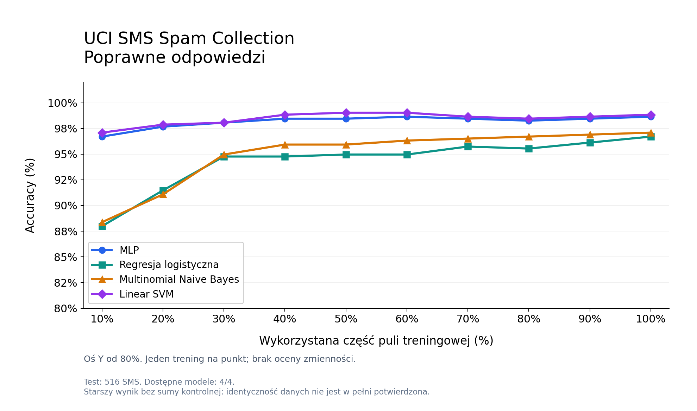
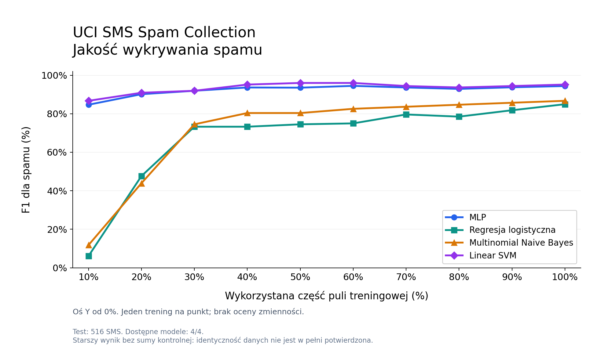
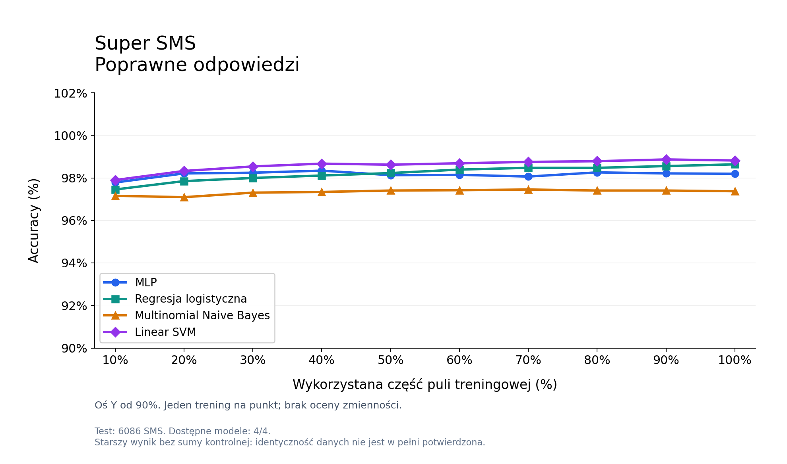
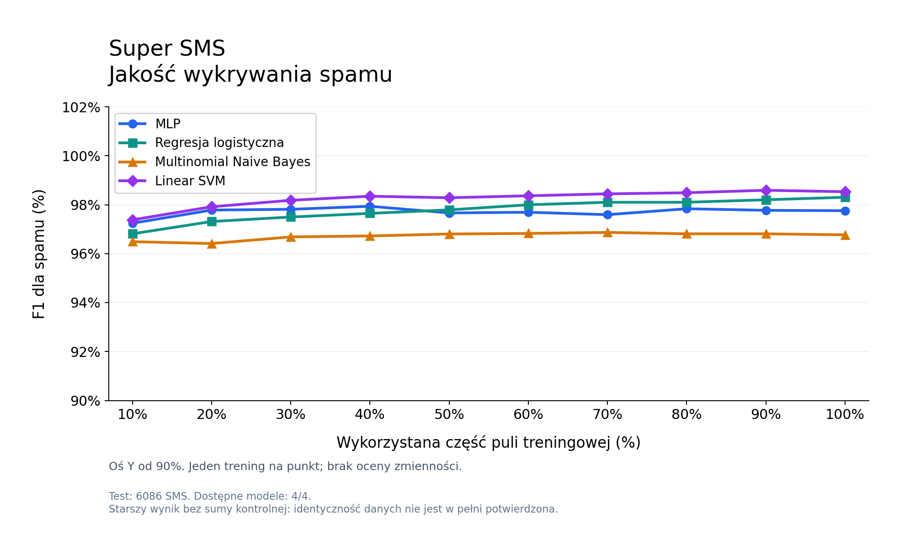

# Klasyfikacja SMS: porównanie czterech modeli

## Cel badania

Sprawdzamy, jak ilość danych treningowych wpływa na wykrywanie spamu oraz czy sieć neuronowa przewyższa trzy prostsze modele. Rozróżniamy **ham** (zwykłe wiadomości) i **spam** (niechciane wiadomości).

## Dwa niezależne badania

| Zbiór | Przed czyszczeniem | Po czyszczeniu | Ham | Spam |
|---|---:|---:|---:|---:|
| UCI SMS Spam Collection | 5 574 | 5 156 | 4 514 | 642 |
| Super SMS | 67 010 | 60 858 | 36 309 | 24 549 |

Normalizujemy tekst oraz usuwamy niepoprawne rekordy, duplikaty i grupy ze sprzecznymi etykietami. W Super SMS dodatkowo odrzucamy krótkie lub uszkodzone wpisy, powtarzające się szablony i pokrycia z oryginalnym UCI. Oryginalne dane pozostają bez zmian.

**Nie porównujemy zbiorów między sobą.** W każdym badaniu osobno porównujemy cztery algorytmy przy rosnącej liczbie przykładów treningowych.

## Modele i metoda

Każdy model korzysta z tych samych ustawień **TF-IDF — do 3 000 cech**:

| Model | Podejście | Ustawienia |
|---|---|---|
| MLP | Sieć neuronowa | 32 neurony w warstwie ukrytej, ReLU, Adam, do 100 iteracji |
| Regresja logistyczna | Model liniowy | L2, C=1, do 1 000 iteracji |
| Multinomial Naive Bayes | Model probabilistyczny | Wygładzanie alpha=1 |
| Linear SVM | Liniowa granica o maksymalnym marginesie | C=1, do 5 000 iteracji |

Dla każdego zbioru odkładamy **10% wiadomości na test**. Każdy algorytm uczymy osobno na **10%, 20%, …, 100% pozostałej puli treningowej**. Mniejsze próbki zawierają się w większych. Modele otrzymują te same podwybory i test w ramach danego badania; TF-IDF dopasowujemy tylko do aktualnej próbki treningowej. Losowanie jest powtarzalne (`random_state=42`). Parametrów nie dobieramy na teście.

## Wyniki

Ocenę opieramy na **accuracy** (poprawne odpowiedzi), **precision** (poprawność alarmów), **recall** (wykryta część spamu) i **F1** (średnia harmoniczna precision i recall).

Oś X pokazuje procent wykorzystanej puli treningowej, oś Y — wartość miary, a każda linia — jeden model. Wykresy pokazują dostępne wyniki, także przed zakończeniem wszystkich czterech modeli; liczba dostępnych algorytmów jest podana pod wykresem. Brakujące wyniki nie są uzupełniane sztucznie.

### Badanie 1 · UCI





### Badanie 2 · Super SMS





Osobne wykresy precision i recall oraz wykresy każdego modelu zapisują się w folderach wyników. Ścieżki głównych wykresów pozostają takie same po dodaniu nowych modeli.

## Ograniczenia

Każdy punkt to pojedyncze uczenie, bez oszacowania zmienności między losowaniami. Czyszczenie szablonów jest heurystyką; nie wykrywa wszystkich podobieństw znaczeniowych i może łączyć różne wiadomości. Nie wykonano ręcznej kontroli wszystkich etykiet ani automatycznego rozpoznawania języka. Odczyt Super SMS jako latin-1 nie naprawia wszystkich możliwych błędów kodowania.

Starsze wyniki MLP nie mają sumy kontrolnej danych. Zgodność zapisanych parametrów podziału jest sprawdzana, ale identyczność danych nie jest wtedy w pełni potwierdzona; wykres zawiera odpowiednią uwagę. Nie formułujemy wniosku o przewadze modelu przed uzyskaniem wyników.

## Uruchomienie

Instalacja: `python -m pip install -r requirements.txt`.

Uczenie **tylko dwóch nowych modeli**, bez uruchamiania uczenia MLP i regresji logistycznej:

```powershell
python main.py --train --model new
```

Odświeżenie wszystkich wykresów z zapisanych wyników, **bez uczenia**:

```powershell
python plots.py
```

Modele zapisują się w `models/<zbiór>/`. Zgodne zapisane modele są ładowane ponownie. Wyniki nowych algorytmów znajdują się w `results/<zbiór>/naive_bayes/` i `results/<zbiór>/svm/`.

## Źródła

- [UCI SMS Spam Collection](https://archive.ics.uci.edu/dataset/228/sms+spam+collection).
- [Super SMS — dane i kod autorów](https://github.com/smspamresearch/spstudy): Salman, Ikram, Kaafar (2024), *Investigating Evasive Techniques in SMS Spam Filtering: A Comparative Analysis of Machine Learning Models*, IEEE Access.
