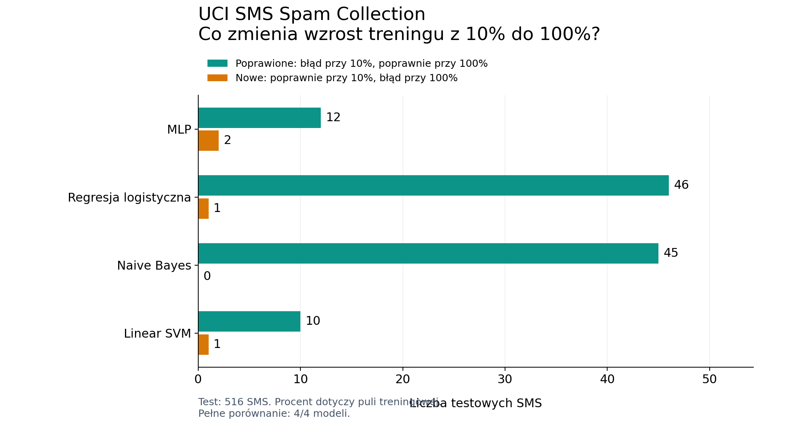

# Wpływ wielkości zbioru treningowego i wyboru modelu na klasyfikację SMS

## Cel badania

Sprawdzamy dwa równorzędne zagadnienia: **wpływ ilości danych treningowych** oraz **wpływ wyboru algorytmu** na wykrywanie spamu. Eksperymenty wykonujemy oddzielnie dla UCI i Super SMS. Nie porównujemy zbiorów między sobą.

## Dane i metoda

| Zbiór | Wiadomości po czyszczeniu | Ham | Spam | Test |
|---|---:|---:|---:|---:|
| UCI SMS Spam Collection | 5 156 | 4 514 | 642 | 516 |
| Super SMS | 60 858 | 36 309 | 24 549 | 6 086 |

**Ham** to zwykła wiadomość, **spam** — niechciana. Usuwamy niepoprawne rekordy, duplikaty i sprzeczne etykiety. W Super SMS wykluczamy także krótkie lub uszkodzone wpisy, powtarzające się szablony oraz pokrycia z oryginalnym UCI. Oryginały zachowujemy bez zmian.

Porównujemy cztery modele korzystające z **TF-IDF, do 3 000 cech**:

- **MLP:** warstwa ukryta z 32 neuronami, ReLU, Adam.
- **Regresja logistyczna:** regularyzacja L2, C=1.
- **Multinomial Naive Bayes:** alpha=1.
- **Linear SVM:** C=1.

W każdym badaniu 10% danych odkładamy na test. Modele uczymy na **10%, 20%, …, 100% pozostałej puli**. Dostają te same próbki i test; mniejsze próbki zawierają się w większych. TF-IDF dopasowujemy wyłącznie do aktualnego treningu (`random_state=42`).

**Accuracy** mierzy wszystkie poprawne odpowiedzi, **precision** — poprawność alarmów, **recall** — wykrytą część spamu, a **F1** łączy precision i recall. Ze względu na nierówne proporcje klas nie ograniczamy oceny do accuracy.

## Badanie 1 · UCI

| Model | F1 przy 10% treningu | F1 przy 100% treningu | Accuracy przy 100% |
|---|---:|---:|---:|
| MLP | 84,68% | 94,40% | 98,64% |
| Regresja logistyczna | 6,06% | 84,96% | 96,71% |
| Naive Bayes | 11,76% | 86,73% | 97,09% |
| Linear SVM | 86,73% | 95,16% | 98,84% |


**Obserwacje:** wszystkie modele osiągnęły wyższe F1 przy pełnej próbce niż przy 10%. Regresja logistyczna i Naive Bayes przy małej próbce pomijały większość spamu. Najwyższe końcowe F1 uzyskał SVM, lecz jego przewaga nad MLP w accuracy odpowiada tylko **jednej wiadomości testowej** — nie jest to dowód istotnej przewagi.

## Badanie 2 · Super SMS

| Model | F1 przy 10% treningu | F1 przy 100% treningu | Accuracy przy 100% |
|---|---:|---:|---:|
| MLP | 97,24% | 97,76% | 98,19% |
| Regresja logistyczna | 96,81% | 98,30% | 98,64% |
| Naive Bayes | 96,49% | 96,77% | 97,37% |
| Linear SVM | 97,38% | 98,53% | 98,82% |


**Obserwacje:** przy 10% puli wszystkie modele miały już wysokie F1, a dalszy wzrost był ograniczony. Przy pełnym treningu SVM i regresja logistyczna uzyskały wyższe F1 niż MLP. Większa złożoność modelu nie zapewniła lepszego wyniku. Zmiany na pośrednich rozmiarach nie muszą być monotoniczne.

Na wykresach oś X oznacza udział puli treningowej, a linie — algorytmy. Skala Y kończy się na 100%; dolna granica jest podana na wykresie. Pełne tabele i pozostałe miary znajdują się w `results/`.

<!-- ERROR_ANALYSIS:START -->

## Analiza błędów

**FP** to zwykły SMS uznany za spam, a **FN** — przeoczony spam. Porównanie 10% i 100% treningu dotyczy tego samego testu wewnątrz każdego badania.

### UCI SMS Spam Collection

Porównanie obejmuje **4/4 modeli** przy 10% i 100% treningu.




[Wnioski i omówione przykłady SMS](results/uci/error_analysis/report.md)


### Super SMS

Porównanie obejmuje **4/4 modeli** przy 10% i 100% treningu.


[Wnioski i omówione przykłady SMS](results/super_sms/error_analysis/report.md)


Komentarze do treści są hipotezami, nie dowodem przyczyny decyzji. Nie zmieniamy etykiet ani parametrów na podstawie tego testu.

<!-- ERROR_ANALYSIS:END -->

## Ograniczenia

Jeden podział danych nie wystarcza do potwierdzenia istotnej przewagi modelu. Osiągnięcie limitu iteracji MLP jest zaznaczone w tabelach wynikowych. Czyszczenie szablonów jest heurystyką; nie wykonano pełnej kontroli etykiet, języka i kodowania. Interpretacje treści błędnych SMS są hipotezami, a podejrzanych etykiet nie zmieniamy samodzielnie.

Analiza błędów opisuje test po ocenie. Nie dostrajamy modeli na tym samym teście; dalsze ulepszenia wymagają osobnej walidacji. Zgodność miar po zmianie bibliotek nie dowodzi identyczności każdej predykcji; szczegóły zapisano w manifestach.

## Odtworzenie wykresów i analizy

Modele są już zapisane. Poniższe polecenia **nie uruchamiają uczenia**:

```powershell
python error_analysis.py
python plots.py
```

Analiza automatycznie aktualizuje swój rozdział README, dodając wyłącznie istniejące wykresy i raporty. Biblioteki: `python -m pip install -r requirements.txt`. Aby obrazy były widoczne na GitHubie, należy przesłać także pliki z `results/`.

## Źródła

- [UCI SMS Spam Collection](https://archive.ics.uci.edu/dataset/228/sms+spam+collection).
- [Super SMS — dane i kod autorów](https://github.com/smspamresearch/spstudy): Salman, Ikram, Kaafar (2024), *Investigating Evasive Techniques in SMS Spam Filtering: A Comparative Analysis of Machine Learning Models*, IEEE Access.

