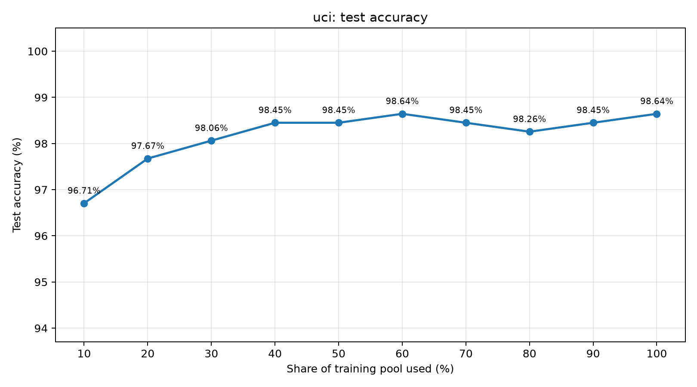
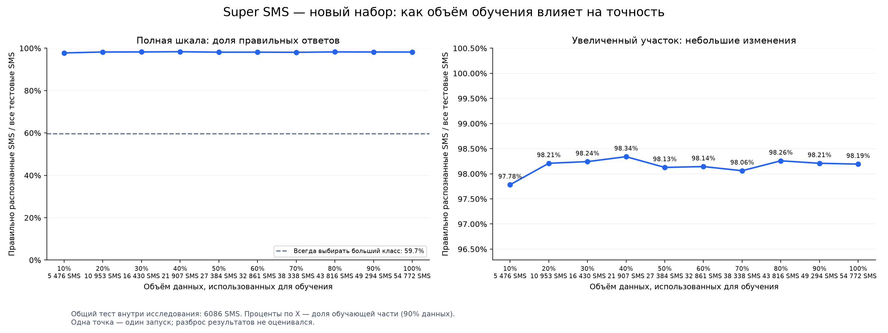

# 📱 SMS AI — wykrywanie spamu

### Jak ilość danych wpływa na skuteczność sieci neuronowej?

Projekt z uczenia maszynowego: dwa niezależne eksperymenty na wiadomościach SMS.

---

## 01 · Cel projektu

Klasyfikujemy wiadomości do dwóch klas:

- **ham** — zwykła wiadomość;
- **spam** — niechciana wiadomość.

Sprawdzamy, jak zmieniają się wyniki tej samej architektury sieci, gdy zwiększamy liczbę przykładów treningowych.

## 02 · Dwa badania

| | Badanie 1: UCI | Badanie 2: Super SMS |
|---|---:|---:|
| Wiadomości przed czyszczeniem | 5 574 | 67 010 |
| Wiadomości po czyszczeniu | 5 156 | 60 858 |
| Zwykłe wiadomości | 4 514 | 36 309 |
| Spam | 642 | 24 549 |
| Zbiór treningowy | 4 640 | 54 772 |
| Zbiór testowy | 516 | 6 086 |

**Nie łączymy zbiorów.** Z Super SMS usuwamy także wiadomości pokrywające się z oryginalnym UCI według reguł opisanych poniżej.

## 03 · Przygotowanie danych

1. Normalizacja Unicode i odstępów oraz usunięcie niewidocznych znaków.
2. Odrzucenie niepoprawnych etykiet i pustych wiadomości lub tekstów bez liter łacińskich.
3. Usunięcie duplikatów; w grupach ze sprzecznymi etykietami odrzucamy wszystkie wiadomości.
4. W Super SMS dodatkowo odrzucamy teksty krótsze niż 5 znaków oraz zawierające znaki kontrolne lub znak zastępczy.
5. W Super SMS porównujemy szablony: ignorujemy wielkość liter i interpunkcję, a adresy URL, e-mail i liczby zastępujemy znacznikami. Pozostaje jeden przykład każdego szablonu.
6. Usuwamy dokładne i szablonowe pokrycia Super SMS z całym oryginalnym UCI.

W Super SMS wykluczono **4 434 pokrycia z UCI**, **1 084 powtórzenia szablonów**, **632 krótkie lub uszkodzone rekordy** i **2 rekordy z niepoprawną etykietą**.

Oryginały pozostają bez zmian. Oczyszczone dane, odrzucone rekordy z przyczynami i raport znajdują się w `data/clean/`.

> Czyszczenie szablonów jest heurystyką: może połączyć różne wiadomości, a nie wykrywa wszystkich podobieństw znaczeniowych. Nie wykonano ręcznej kontroli wszystkich etykiet ani automatycznego rozpoznawania języka. Super SMS odczytujemy jako latin-1, podobnie jak autorzy; nie naprawia to wszystkich możliwych błędów kodowania.

## 04 · Model i plan eksperymentu

**Tekst SMS → TF-IDF (do 3 000 cech) → MLP (32 neurony w warstwie ukrytej) → ham / spam**

Dla każdego zbioru uczymy **10 modeli od początku**, z taką samą architekturą:

**10% → 20% → 30% → 40% → 50% → 60% → 70% → 80% → 90% → 100%**

- Podział: **90% trening / 10% test**, z zachowaniem proporcji klas.
- Procenty dotyczą wyłącznie części treningowej.
- Mniejsze próbki treningowe zawierają się w większych.
- Test jest stały dla wszystkich 10 modeli w ramach danego badania.
- TF-IDF dopasowujemy wyłącznie do aktualnej próbki treningowej.
- `random_state=42`, maksymalnie 100 iteracji uczenia.

## 05 · Ocena jakości

| Miara | Co mierzy? |
|---|---|
| Accuracy | Odsetek poprawnie sklasyfikowanych SMS |
| Precision dla spamu | Jaka część wiadomości oznaczonych jako spam rzeczywiście jest spamem |
| Recall dla spamu | Jaką część rzeczywistego spamu wykrywa model |
| F1 dla spamu | Średnia harmoniczna precision i recall |

Sama accuracy nie wystarcza przy nierównych proporcjach klas. Dlatego zapisujemy również precision, recall i F1.

### Badanie 1 · UCI



[Pełna tabela wyników](results/uci/metrics.csv) · [Opis podziału danych](results/uci/split.json)

### Badanie 2 · Super SMS



[Pełna tabela wyników](results/super_sms/metrics.csv) · [Opis podziału danych](results/super_sms/split.json)

Pliki wynikowe powstają po zakończeniu danego badania. Kolumna `converged` informuje, czy uczenie zakończyło się bez ostrzeżenia o osiągnięciu limitu iteracji.

## 06 · Jak interpretować wyniki?

Porównujemy przede wszystkim wzrost jakości **wewnątrz każdego badania**. Dwa zbiory mają inne testy i proporcje klas — różnicy wyników między nimi nie można przypisać wyłącznie liczbie danych.

Każdy punkt to pojedyncze uczenie. Nie oszacowano zmienności między losowaniami. Do doboru parametrów potrzebny będzie osobny zbiór walidacyjny; test nie powinien służyć do wybierania modelu. Wyniki nie gwarantują skuteczności na dowolnych nowych SMS.

## 07 · Uruchomienie

```powershell
python -m pip install -r requirements.txt
python main.py
```

Tylko jedno badanie:

```powershell
python main.py --dataset uci
python main.py --dataset super_sms
```

Samo czyszczenie: `python prepare_data.py`.

Wykresy z zapisanych wyników, bez uczenia: `python main.py --plot-only`.

## 08 · Struktura projektu

```text
main.py                     # dwa eksperymenty i wykresy
prepare_data.py             # czyszczenie i kontrola pokrycia danych
requirements.txt            # biblioteki
SMSSpamCollection           # oryginalne UCI
 data/
  super_sms/                # oryginalny Super SMS
  clean/                    # dane po czyszczeniu i raport
results/
  uci/                      # wyniki badania 1
  super_sms/                # wyniki badania 2
```

Starsze pliki bezpośrednio w `results/` pochodzą z poprzednich wersji eksperymentu.

## Źródła

- [UCI SMS Spam Collection](https://archive.ics.uci.edu/dataset/228/sms+spam+collection).
- [Super SMS — dane i kod autorów](https://github.com/smspamresearch/spstudy).
- Salman, Ikram, Kaafar (2024), *Investigating Evasive Techniques in SMS Spam Filtering: A Comparative Analysis of Machine Learning Models*, IEEE Access.

Przy korzystaniu z danych należy uwzględnić warunki źródeł i cytować autorów. Mapowanie Super SMS: `0 = ham`, `1 = spam`; zgodność sprawdzono na pokrywających się wiadomościach UCI, wykrywając również jedną rozbieżną etykietę (wiadomość wykluczona z nowego badania).
