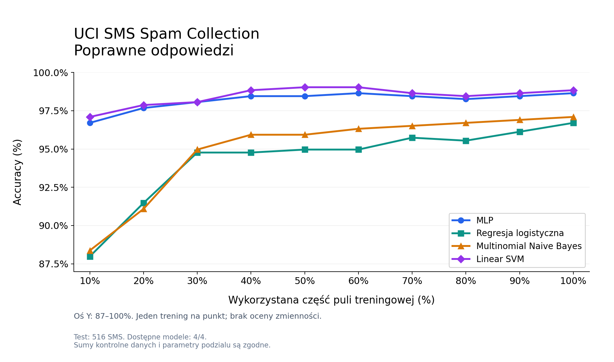
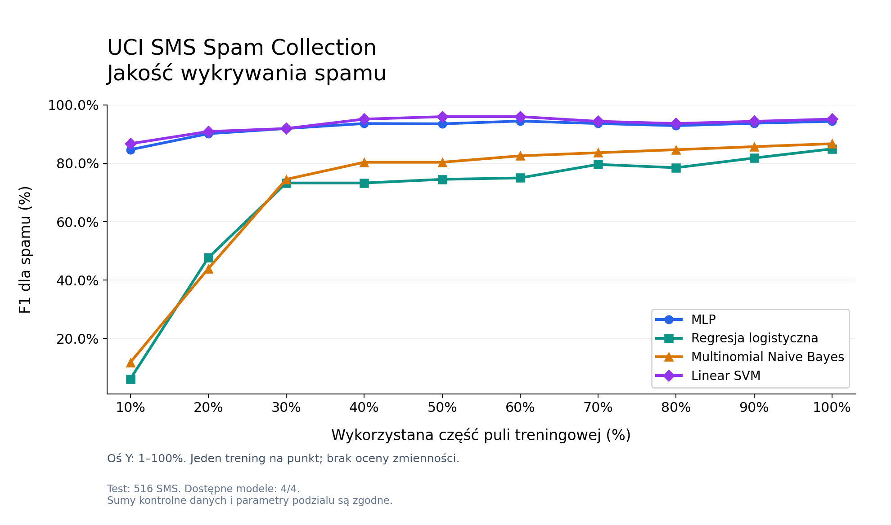
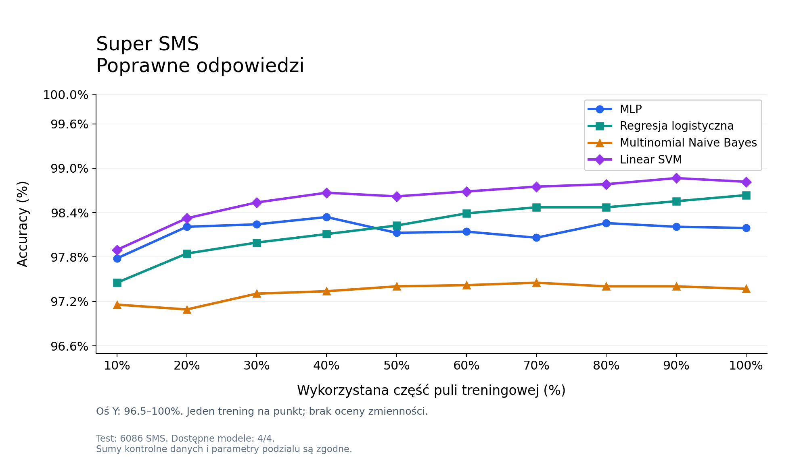
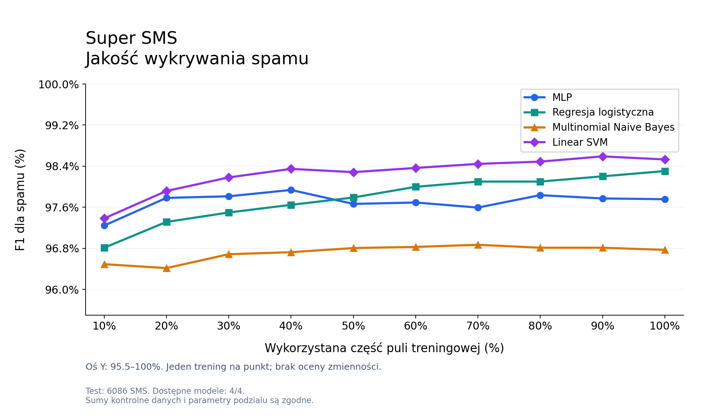
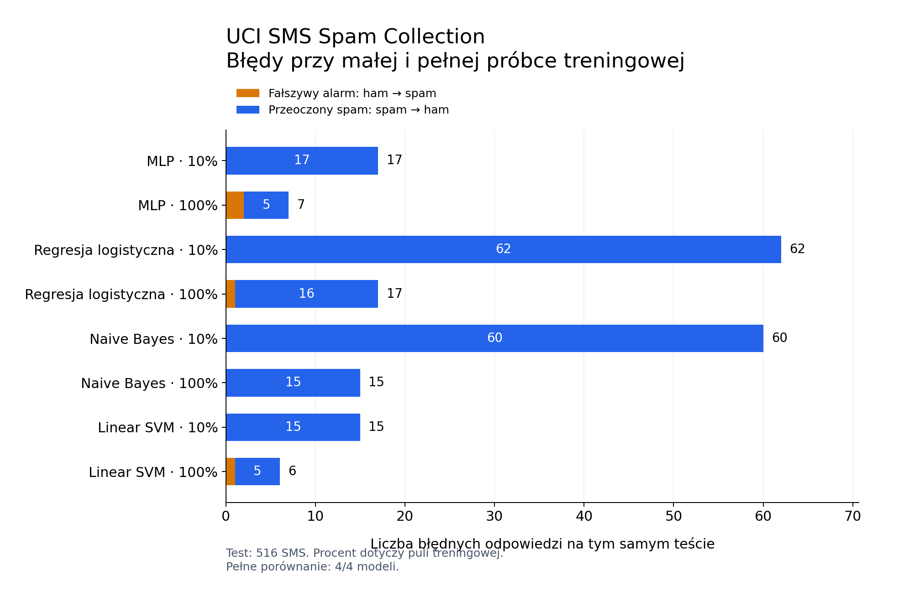
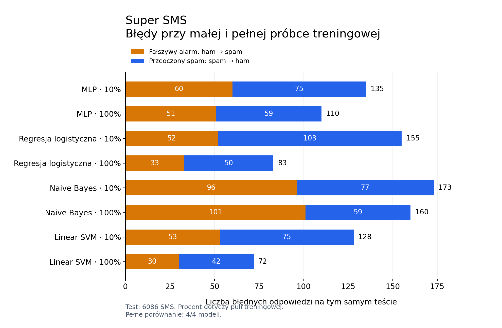
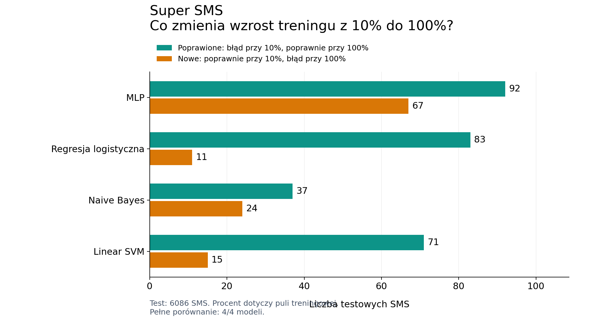

# Wpływ wielkości zbioru treningowego i wyboru modelu na klasyfikację SMS

## Cel i dane

Badamy dwa równorzędne pytania: **jak ilość danych wpływa na jakość klasyfikacji** oraz **jak wybór algorytmu wpływa na wynik przy tej samej ilości danych**. Prowadzimy osobne eksperymenty na UCI i Super SMS; nie porównujemy tych zbiorów ze sobą.

| Zbiór | Przed czyszczeniem | Po czyszczeniu | Ham | Spam |
|---|---:|---:|---:|---:|
| UCI SMS Spam Collection | 5 574 | 5 156 | 4 514 | 642 |
| Super SMS | 67 010 | 60 858 | 36 309 | 24 549 |

**Ham** oznacza zwykłą wiadomość, **spam** — niechcianą. Normalizujemy tekst, usuwamy niepoprawne rekordy, duplikaty i grupy ze sprzecznymi etykietami. W Super SMS dodatkowo odrzucamy krótkie lub uszkodzone wpisy, powtarzające się szablony i pokrycia z oryginalnym UCI. Oryginały pozostają bez zmian.

## Metoda

Porównujemy **MLP** (32 neurony, ReLU), **regresję logistyczną** (L2, C=1), **Multinomial Naive Bayes** (alpha=1) i **Linear SVM** (C=1). Wszystkie korzystają z TF-IDF, do 3 000 cech.

Dla każdego zbioru odkładamy **10% na test**. Każdy model uczymy na **10%, 20%, …, 100% pozostałej puli**. Mniejsze próbki zawierają się w większych. Algorytmy otrzymują te same podwybory i test, a TF-IDF dopasowujemy wyłącznie do aktualnej próbki treningowej (`random_state=42`). Nie dobieramy parametrów na teście. Osiągnięcie limitu iteracji jest zaznaczone w wynikach.

Oceniamy **accuracy** (poprawne odpowiedzi), **precision** (poprawność alarmów), **recall** (wykryta część spamu) i **F1** (średnia harmoniczna precision i recall).

## Wyniki eksperymentów

Oś X oznacza wielkość treningu, a linie — modele. Skala Y kończy się na 100%; jej dolna granica jest podana na wykresie. Pełne tabele i dodatkowe miary znajdują się w folderach wyników.

### Badanie 1 · UCI





### Badanie 2 · Super SMS





## Analiza błędów · 10% a 100% treningu

Sprawdzamy, **jak zmieniają się pomyłki na tych samych testowych SMS**, gdy rośnie zbiór treningowy:

- **FP:** zwykły SMS błędnie uznany za spam.
- **FN:** spam błędnie uznany za zwykły SMS.
- **Poprawiony błąd:** błędna odpowiedź przy 10%, poprawna przy 100%.
- **Nowy błąd:** poprawna odpowiedź przy 10%, błędna przy 100%.

### UCI




[Krótki raport: liczby, wnioski i omówione przykłady](results/uci/error_analysis/report.md)

### Super SMS





[Krótki raport: liczby, wnioski i omówione przykłady](results/super_sms/error_analysis/report.md)

Raport automatycznie podaje zmianę liczby błędów każdego modelu oraz omawia wybrane wiadomości: reklamowe znaczenie zwykłych słów, płatne oferty udające rozmowę, powiadomienia o dostawie i niejednoznaczne etykiety. Są to interpretacje treści, nie udowodnione przyczyny decyzji. Nie zmieniamy etykiet na podstawie opinii modelu. Szczegółowe predykcje i listy błędnych SMS pozostają w podfolderach `10/` i `100/`.

**Kompletność jest sprawdzana:** brak zapisanego modelu daje oznaczenie niepełnego porównania, a nie fikcyjny wynik. Wykresy i raporty tego etapu powstają po uruchomieniu analizy.

## Ograniczenia

Jeden podział danych nie pozwala wykazać istotnej przewagi algorytmu. Wysoka accuracy może ukrywać przeoczony spam, dlatego analizujemy także recall i F1. Czyszczenie szablonów jest heurystyką; nie przeprowadzono pełnej kontroli etykiet, języka i kodowania. Podejrzane etykiety pozostają zgodne ze źródłem.

Analiza błędów opisuje test po ocenie. Nie dostrajamy modeli na tym samym teście; kolejne ulepszenia wymagają osobnej walidacji. Przy zmianie wersji bibliotek sprawdzamy zgodność z wcześniejszymi miarami, lecz nie stanowi to dowodu identyczności każdej predykcji. Szczegóły zawierają manifesty. Starsze tabele MLP bez podpisu danych są oznaczane na wykresach.

## Uruchomienie

Instalacja: `python -m pip install -r requirements.txt`.

Brakujące zapisane MLP trzeba uzyskać **jednorazowo**, jawnie uruchamiając uczenie tej sieci. Pozostałe modele nie są wtedy uczone:

```powershell
python main.py --train --model mlp
```

Następnie analiza obu zbiorów przy 10% i 100%, bez uczenia:

```powershell
python error_analysis.py
```

Odświeżenie głównych wykresów z tabel, również bez uczenia:

```powershell
python plots.py
```

README ma już docelowe ścieżki obrazów i raportów. Do wyświetlenia na GitHubie trzeba przesłać również wygenerowane pliki z `results/`.

## Źródła

- [UCI SMS Spam Collection](https://archive.ics.uci.edu/dataset/228/sms+spam+collection).
- [Super SMS — dane i kod autorów](https://github.com/smspamresearch/spstudy): Salman, Ikram, Kaafar (2024), *Investigating Evasive Techniques in SMS Spam Filtering: A Comparative Analysis of Machine Learning Models*, IEEE Access.
