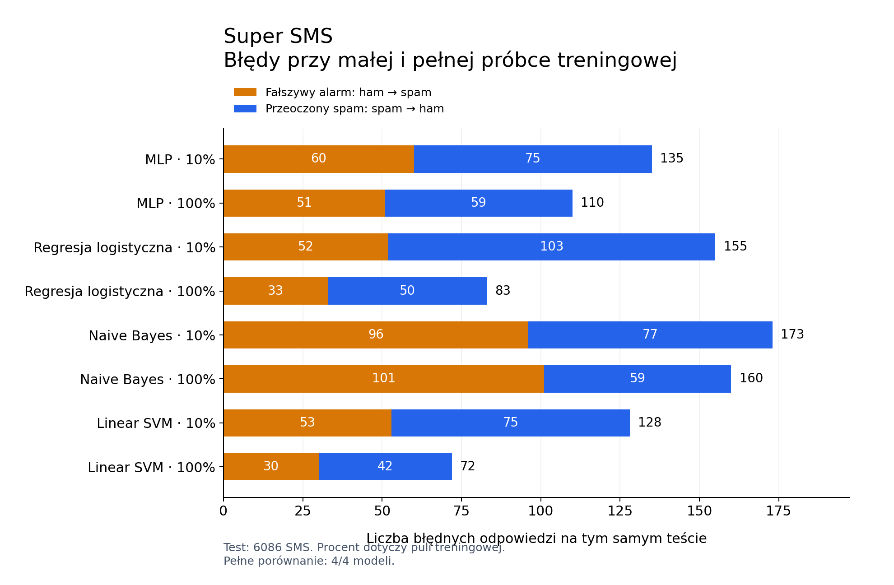
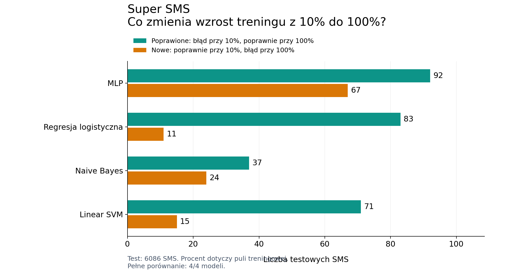

# Analiza błędów · Super SMS

Ten sam test: **6086 SMS** (3631 ham, 2455 spam). Porównujemy modele przy 10% i 100% puli treningowej, bez zmiany progu decyzji.

**Status: Pełne porównanie: 4/4 modeli.**

## Liczby i zmiana błędów

FP: zwykły SMS uznany za spam. FN: przeoczony spam.

| Model | FP: 10% → 100% | FN: 10% → 100% | Poprawione | Nowe |
|---|---:|---:|---:|---:|
| MLP | 60 → 51 | 75 → 59 | 92 | 67 |
| Regresja logistyczna | 52 → 33 | 103 → 50 | 83 | 11 |
| Multinomial Naive Bayes | 96 → 101 | 77 → 59 | 37 | 24 |
| Linear SVM | 53 → 30 | 75 → 42 | 71 | 15 |

## Wnioski liczbowe

- **MLP:** liczba błędów spadła o 25 (135 → 110). Poprawiono 92 SMS, wprowadzono 67 nowych pomyłek; 43 pozostało błędnych.
- **Regresja logistyczna:** liczba błędów spadła o 72 (155 → 83). Poprawiono 83 SMS, wprowadzono 11 nowych pomyłek; 72 pozostało błędnych.
- **Multinomial Naive Bayes:** liczba błędów spadła o 13 (173 → 160). Poprawiono 37 SMS, wprowadzono 24 nowych pomyłek; 136 pozostało błędnych.
- **Linear SVM:** liczba błędów spadła o 56 (128 → 72). Poprawiono 71 SMS, wprowadzono 15 nowych pomyłek; 57 pozostało błędnych.

Poprawione i nowe błędy liczymy dla tych samych wiadomości, nie z różnicy samych sum. Więcej danych może równocześnie usuwać część pomyłek i wprowadzać inne.

## Krótki przegląd treści

Przykłady wybrano jakościowo z wcześniejszego raportu. Nie są losową ani reprezentatywną próbą. Komentarze są interpretacją treści, nie dowodem przyczyny decyzji modelu.

### Powiadomienie o dostawie a podejrzana oferta

<blockquote>
Your order from AMAZON booked vide GATI DKT 502024095 is out for delivery, Contact Person: SOURAV/9932909134
</blockquote>

Etykieta zbioru: **ham**.
Błąd przy 10%: MLP, Regresja logistyczna, Multinomial Naive Bayes, Linear SVM.
Błąd przy 100%: MLP, Regresja logistyczna, Multinomial Naive Bayes, Linear SVM.

Według zbioru jest to ham. Tekst zawiera markę, dostawę i numer telefonu, czyli elementy spotykane również w oszustwach. Samo występowanie tych elementów nie wystarcza do uznania wiadomości za spam.

### Rozmowny tekst z etykietą spam

<blockquote>
rofl i knew how u get to track my progress i should say its a crappy paper but it has come out really well impact wise though p its beeeeeen long since we saw each othr goodnight da gonna sleep
</blockquote>

Etykieta zbioru: **spam**.
Błąd przy 10%: MLP, Regresja logistyczna, Multinomial Naive Bayes, Linear SVM.
Błąd przy 100%: MLP, Regresja logistyczna, Multinomial Naive Bayes, Linear SVM.

Treść przypomina prywatną rozmowę o publikacji i postępach; nie zawiera oczywistej oferty. Etykieta spam może wymagać kontroli w kontekście źródła. Nie zmieniamy jej na podstawie samego tekstu ani zgodności modeli.

### Możliwa niejednoznaczność etykiety

<blockquote>
dunnom still on painkillers so i dunno how much pain there when they take me off itdepending on that i can sty or leave
</blockquote>

Etykieta zbioru: **spam**.
Błąd przy 10%: MLP, Regresja logistyczna, Multinomial Naive Bayes, Linear SVM.
Błąd przy 100%: MLP, Regresja logistyczna, Multinomial Naive Bayes, Linear SVM.

Tekst opisuje samopoczucie i leki, a w zbiorze ma etykietę spam. To przykład do weryfikacji jakości danych, nie dowód, że model ma rację. Zachowujemy oryginalną etykietę przy obliczaniu miar.

## Granice wniosków

To opis błędów na teście po końcowej ocenie. Nie zmieniamy etykiet, progu ani parametrów na podstawie tych samych przykładów. Nie jest to pomiar poprawy po dostrojeniu modelu. Jeden podział danych nie wystarcza do wykazania istotnej przewagi algorytmu. Przy różnych wersjach bibliotek zgodność miar zbiorczych nie dowodzi identyczności każdej predykcji; szczegóły kontroli są w manifestach dla 10% i 100%.

Pełne predykcje, błędne SMS, wspólne pomyłki i segmenty długości/URL pozostają w podfolderach odpowiednich rozmiarów treningu.
