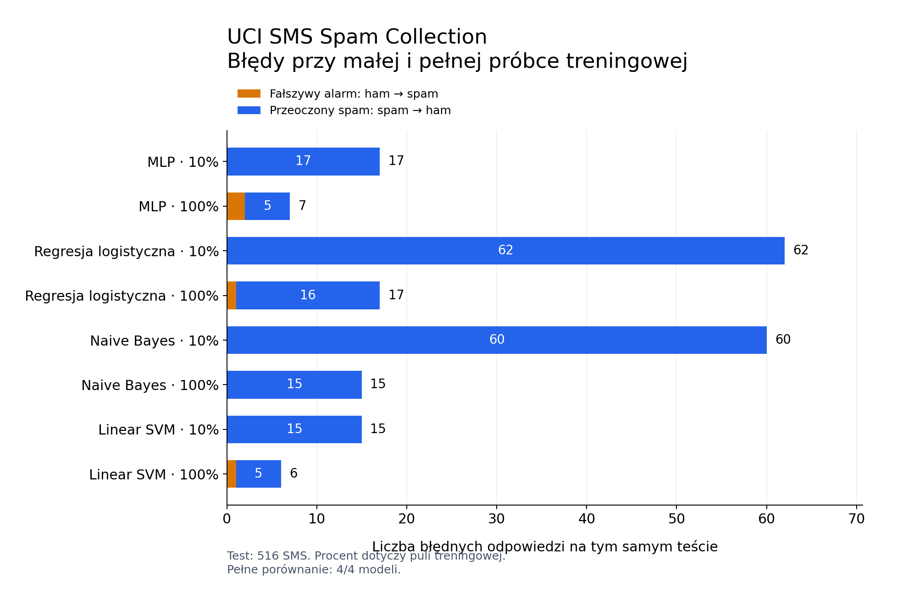
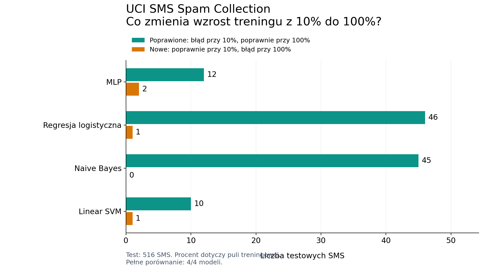

# Analiza błędów · UCI SMS Spam Collection

Ten sam test: **516 SMS** (452 ham, 64 spam). Porównujemy modele przy 10% i 100% puli treningowej, bez zmiany progu decyzji.

**Status: Pełne porównanie: 4/4 modeli.**

## Liczby i zmiana błędów

FP: zwykły SMS uznany za spam. FN: przeoczony spam.

| Model | FP: 10% → 100% | FN: 10% → 100% | Poprawione | Nowe |
|---|---:|---:|---:|---:|
| MLP | 0 → 2 | 17 → 5 | 12 | 2 |
| Regresja logistyczna | 0 → 1 | 62 → 16 | 46 | 1 |
| Multinomial Naive Bayes | 0 → 0 | 60 → 15 | 45 | 0 |
| Linear SVM | 0 → 1 | 15 → 5 | 10 | 1 |

## Wnioski liczbowe

- **MLP:** liczba błędów spadła o 10 (17 → 7). Poprawiono 12 SMS, wprowadzono 2 nowych pomyłek; 5 pozostało błędnych.
- **Regresja logistyczna:** liczba błędów spadła o 45 (62 → 17). Poprawiono 46 SMS, wprowadzono 1 nowych pomyłek; 16 pozostało błędnych.
- **Multinomial Naive Bayes:** liczba błędów spadła o 45 (60 → 15). Poprawiono 45 SMS, wprowadzono 0 nowych pomyłek; 15 pozostało błędnych.
- **Linear SVM:** liczba błędów spadła o 9 (15 → 6). Poprawiono 10 SMS, wprowadzono 1 nowych pomyłek; 5 pozostało błędnych.

Poprawione i nowe błędy liczymy dla tych samych wiadomości, nie z różnicy samych sum. Więcej danych może równocześnie usuwać część pomyłek i wprowadzać inne.

## Krótki przegląd treści

Przykłady wybrano jakościowo z wcześniejszego raportu. Nie są losową ani reprezentatywną próbą. Komentarze są interpretacją treści, nie dowodem przyczyny decyzji modelu.

### Zwykła rozmowa z wyrazami podobnymi do reklamy

<blockquote>
Are you free now?can i call now?
</blockquote>

Etykieta zbioru: **ham**.
Błąd przy 10%: brak w dostępnych modelach.
Błąd przy 100%: Regresja logistyczna, Linear SVM.

Wiadomość pyta o możliwość rozmowy. Słowa free i call występują również w reklamach, lecz tutaj mają zwykłe znaczenie. To hipoteza o trudności reprezentacji słownej, a nie potwierdzone wyjaśnienie decyzji modelu.

### Oferta nagrody rozpoznana jako zwykła wiadomość

<blockquote>
Camera - You are awarded a SiPix Digital Camera! call 09061221066 fromm landline. Delivery within 28 days
</blockquote>

Etykieta zbioru: **spam**.
Błąd przy 10%: Regresja logistyczna, Multinomial Naive Bayes.
Błąd przy 100%: Regresja logistyczna.

Obietnica aparatu i polecenie telefonu tworzą strukturę oferty, mimo że nie musi występować dosłowne słowo spam. Ten przykład pokazuje, dlaczego warto oceniać przeoczenia, a nie wyłącznie poprawność alarmów.

### Płatna usługa udająca osobistą rozmowę

<blockquote>
Back 2 work 2morro half term over! Can U C me 2nite 4 some sexy passion B4 I have 2 go back? Chat NOW 09099726481 Luv DENA Calls £1/minMobsmoreLKPOBOX177HP51FL
</blockquote>

Etykieta zbioru: **spam**.
Błąd przy 10%: MLP, Regresja logistyczna, Multinomial Naive Bayes, Linear SVM.
Błąd przy 100%: MLP, Regresja logistyczna, Multinomial Naive Bayes, Linear SVM.

Początek przypomina prywatny kontakt i zawiera skróty, np. 2morro i 2nite. Dalej pojawia się numer oraz opłata za minutę. Mieszanie stylu rozmowy i płatnej oferty jest istotnym przypadkiem do ręcznego omówienia.

## Granice wniosków

To opis błędów na teście po końcowej ocenie. Nie zmieniamy etykiet, progu ani parametrów na podstawie tych samych przykładów. Nie jest to pomiar poprawy po dostrojeniu modelu. Jeden podział danych nie wystarcza do wykazania istotnej przewagi algorytmu. Przy różnych wersjach bibliotek zgodność miar zbiorczych nie dowodzi identyczności każdej predykcji; szczegóły kontroli są w manifestach dla 10% i 100%.

Pełne predykcje, błędne SMS, wspólne pomyłki i segmenty długości/URL pozostają w podfolderach odpowiednich rozmiarów treningu.
